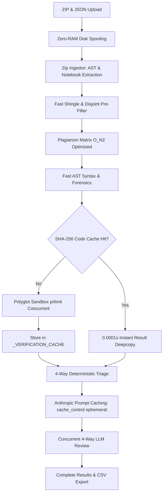

# Polyglot & C Lab Quiz Evaluator (v4.1.0 — Production Edition)

Universal, high-performance triage and evaluation platform for programming labs and written quizzes at **IISER Bhopal (Department of Data Science & Engineering)**.

Designed to evaluate **25+ programming and markup languages** (`.c`, `.cpp`, `.py`, `.ipynb`, `.java`, `.js`, `.ts`, `.rs`, `.go`, `.sql`, `.r`, `.sh`, `.jl`, `.txt`, `.md`, `.tex`, …) with seamless ZIP ingestion, OS-level sandboxing, deterministic plagiarism forensics, and primary 4-way AI triage (`claude-haiku-5-5` with prompt caching).

---

## Table of Contents
1. [Question Paper JSON Creation Guide](#question-paper-json-creation-guide)
   - [Root Schema & Field Reference](#root-schema--field-reference)
   - [Question Specification (`QuestionSpec`) Reference](#question-specification-questionspec-reference)
   - [Copy-Pasteable Example 1: Full C/C++ Program (Stdin / Stdout)](#example-1-full-cc-program-stdin--stdout)
   - [Copy-Pasteable Example 2: Python Script (Sample & Hidden Tests)](#example-2-python-script-sample--hidden-tests)
   - [Copy-Pasteable Example 3: Function-Only Question (Auto-Synthesized Driver)](#example-3-function-only-question-auto-synthesized-driver)
   - [Copy-Pasteable Example 4: Theory / Written / Open-Ended (Rubric & LLM-Only)](#example-4-theory--written--open-ended-rubric--llm-only)
   - [Copy-Pasteable Example 5: Multi-Question Mixed Exam Paper](#example-5-multi-question-mixed-exam-paper)
2. [Dataset Creation & Submission Packaging](#dataset-creation--submission-packaging)
   - [Supported Submission Formats (Zero Renaming Required)](#supported-submission-formats-zero-renaming-required)
   - [Moodle & Google Classroom Direct ZIP Exports](#moodle--google-classroom-direct-zip-exports)
   - [Folder-per-Student Structure](#folder-per-student-structure)
   - [Flat Loose Files in Root](#flat-loose-files-in-root)
   - [Single-Question Quiz Auto-Mapping](#single-question-quiz-auto-mapping)
   - [Comment Header Metadata Fallback](#comment-header-metadata-fallback)
   - [Jupyter Notebook (`.ipynb`) Ingestion](#jupyter-notebook-ipynb-ingestion)
   - [What Gets Automatically Ignored & Cleaned](#what-gets-automatically-ignored--cleaned)
   - [Upload Constraints & Thresholds](#upload-constraints--thresholds)
3. [Speed & Performance Optimizations (Zero Accuracy Loss)](#speed--performance-optimizations-zero-accuracy-loss)
   - [In-Memory Deterministic Verification Cache (`_VERIFICATION_CACHE`)](#in-memory-deterministic-verification-cache-_verification_cache)
   - [Instant Python AST Syntax Check](#instant-python-ast-syntax-check)
   - [Subprocess Timeout Cleanup & Reap Acceleration](#subprocess-timeout-cleanup--reap-acceleration)
   - [SequenceMatcher & Shingle Disjoint Pre-Filtering](#sequencematcher--shingle-disjoint-pre-filtering)
   - [Anthropic Prompt Caching (`cache_control: ephemeral`)](#anthropic-prompt-caching-cache_control-ephemeral)
   - [Zero-RAM Disk Spooling & 512 MB Memory Clamping](#zero-ram-disk-spooling--512-mb-memory-clamping)
4. [Grading & TA Review Workflow ("Everything Else")](#grading--ta-review-workflow-everything-else)
   - [The 4 Queues: GREEN, BLUE, RED, GRAY](#the-4-queues-green-blue-red-gray)
   - [Human-in-the-Loop (HITL) Calibration](#human-in-the-loop-hitl-calibration)
   - [Plagiarism & Stylometric Collusion Matrix](#plagiarism--stylometric-collusion-matrix)
   - [Gradebook Export (CSV & JSON)](#gradebook-export-csv--json)
5. [Deployment Guide (Render Free Plan, Docker, Local)](#deployment-guide-render-free-plan-docker-local)
   - [Deploying to Render Free Plan](#deploying-to-render-free-plan)
   - [Running Locally with Python](#running-locally-with-python)
   - [Running via Docker](#running-via-docker)
   - [Environment Variables Reference](#environment-variables-reference)

---

## Question Paper JSON Creation Guide

The question paper JSON defines the course, exam title, and per-question rubrics, execution modes, test cases, and constraints.

### Root Schema & Field Reference

```json
{
  "course_code": "DSE-201",
  "quiz_title": "Mid-Semester Practical Examination",
  "default_language": "c",
  "questions": [ ... ]
}
```

| Field | Type | Required | Description |
|---|---|---|---|
| `course_code` | `string` | Yes | Course identifier (e.g. `"DSE-101"`, `"CS-202"`). |
| `quiz_title` | `string` | Yes | Title of the quiz or examination. |
| `default_language` | `string` | No | Fallback language for files without explicit mapping (default: `"c"`). Options: `"c"`, `"cpp"`, `"python"`, `"java"`, `"sql"`, `"bash"`, `"javascript"`, `"auto"`. |
| `questions` | `array` | Yes | List of `QuestionSpec` objects (up to 20 questions). |

---

### Question Specification (`QuestionSpec`) Reference

Each question in `questions` can be customized with granular execution rules:

| Field | Type | Default | Description |
|---|---|---|---|
| `question_id` | `string` | **Required** | Unique identifier matching student filenames: `"Q1"`, `"Q2"`, `"1"`, `"que1"`, etc. |
| `title` | `string` | **Required** | Short descriptive title of the question. |
| `problem_statement` | `string` | `""` | Complete problem description, constraints, and requirements. |
| `language` | `string` | `"auto"` | Target language (`"c"`, `"cpp"`, `"python"`, `"java"`, `"sql"`, `"bash"`, `"javascript"`, `"prose"`, `"auto"`). |
| `execution_mode` | `string` | `"auto"` | `auto` (runs sandbox if test cases exist, otherwise static + LLM), `sandbox` (enforces sandbox execution), `llm_only` (skips sandbox; evaluates via rubric & Claude), `static_only` (deterministic checks only). |
| `test_cases` | `array` | `[]` | List of `TestCase` objects (see below). |
| `grading_rubric` | `string` | `null` | Explicit grading criteria, edge cases, and tab assignment rules for the LLM triage layer. |
| `reference_solution`| `string` | `null` | Canonical instructor solution for reference and AST comparison. |
| `forbidden_constructs`| `array[str]`| `[]` | Keywords or regex patterns forbidden in code (e.g. `["goto", "system", "eval", "qsort"]`). Flagged as `RULE_VIOLATION`. |
| `required_constructs` | `array[str]`| `[]` | Must-have constructs (e.g. `["while", "recursion", "malloc"]`). Missing ones are flagged. |
| `expected_complexity` | `string` | `null` | Algorithmic target (e.g. `"O(N)"`, `"O(N log N)"`, `"O(1)"`). Submissions violating complexity get flagged. |
| `timeout_seconds` | `float` | `null` | Per-test-case wall-clock execution timeout in seconds (defaults to global setting, 3.0s). |
| `float_rel_tol` | `float` | `null` | Relative float tolerance for numerical test comparisons (default: `1e-6`). |
| `float_abs_tol` | `float` | `null` | Absolute float tolerance for numerical test comparisons (default: `1e-6`). |

#### `TestCase` Object Structure:
```json
{
  "input_data": "5\n",
  "expected_output": "10\n",
  "is_sample": true
}
```
- `input_data`: String piped to the student program's standard input.
- `expected_output`: Expected standard output string. Checked with whitespace normalization and scientific notation tolerance.
- `is_sample`: `true` for sample test cases (given in the problem description), `false` for hidden test cases. *Submissions passing only sample cases while failing hidden cases are automatically flagged for sample-input hardcoding/spoofing!*

---

### Example 1: Full C/C++ Program (Stdin / Stdout)

Use this for classic lab problems with standard input and standard output.

```json
{
  "course_code": "DSE-101",
  "quiz_title": "Lab Quiz 1: Pointers & Loops",
  "default_language": "c",
  "questions": [
    {
      "question_id": "Q1",
      "title": "Reverse Array In-Place",
      "language": "c",
      "execution_mode": "sandbox",
      "problem_statement": "Given an integer N followed by N integers, reverse the array in-place using two pointers and print the result separated by spaces.",
      "topic_tags": ["arrays", "pointers", "loops"],
      "expected_complexity": "O(N)",
      "forbidden_constructs": ["qsort", "goto"],
      "required_constructs": ["while", "for"],
      "test_cases": [
        { "input_data": "5\n1 2 3 4 5\n", "expected_output": "5 4 3 2 1", "is_sample": true },
        { "input_data": "1\n42\n", "expected_output": "42", "is_sample": true },
        { "input_data": "6\n10 20 30 40 50 60\n", "expected_output": "60 50 40 30 20 10", "is_sample": false },
        { "input_data": "4\n-1 -5 10 0\n", "expected_output": "0 10 -5 -1", "is_sample": false }
      ]
    }
  ]
}
```

---

### Example 2: Python Script (Sample & Hidden Tests)

Use this for Python data science or algorithmic quizzes.

```json
{
  "course_code": "DSE-201",
  "quiz_title": "Python Algorithms Quiz",
  "default_language": "python",
  "questions": [
    {
      "question_id": "Q1",
      "title": "Count Set Bits",
      "language": "python",
      "execution_mode": "auto",
      "problem_statement": "Read an integer N from standard input and print the number of set bits (1s) in its binary representation.",
      "topic_tags": ["bitwise", "loops"],
      "expected_complexity": "O(log N)",
      "forbidden_constructs": ["bit_count", "bin"],
      "test_cases": [
        { "input_data": "0\n", "expected_output": "0", "is_sample": true },
        { "input_data": "7\n", "expected_output": "3", "is_sample": true },
        { "input_data": "1023\n", "expected_output": "10", "is_sample": false },
        { "input_data": "2147483647\n", "expected_output": "31", "is_sample": false }
      ]
    }
  ]
}
```

---

### Example 3: Function-Only Question (Auto-Synthesized Driver)

When students write LeetCode-style solutions (e.g. `def solve(a, b)` or `int isPrime(int n)`) without writing `main()` or handling `scanf`/`input()`. The evaluator automatically synthesizes an in-memory harness to link and execute against test cases!

```json
{
  "course_code": "CS-202",
  "quiz_title": "Function-Only Data Structures Quiz",
  "default_language": "python",
  "questions": [
    {
      "question_id": "Q1",
      "title": "Two Sum Target",
      "language": "python",
      "execution_mode": "auto",
      "problem_statement": "Implement function `two_sum(nums, target)` that returns the two indices of numbers adding up to target. Output space-separated indices.",
      "test_cases": [
        { "input_data": "[2, 7, 11, 15]\n9\n", "expected_output": "0 1", "is_sample": true },
        { "input_data": "[3, 2, 4]\n6\n", "expected_output": "1 2", "is_sample": true },
        { "input_data": "[3, 3]\n6\n", "expected_output": "0 1", "is_sample": false }
      ]
    }
  ]
}
```

---

### Example 4: Theory / Written / Open-Ended (Rubric & LLM-Only)

Use this for SQL queries, written explanations, code reviews, proofs, or questions without executable tests.

```json
{
  "course_code": "DSE-301",
  "quiz_title": "Database Management & Systems Theory",
  "default_language": "sql",
  "questions": [
    {
      "question_id": "Q1",
      "title": "Second Highest Salary by Department",
      "language": "sql",
      "execution_mode": "llm_only",
      "problem_statement": "Write an SQL query to retrieve the second highest distinct salary for each department from table `Employee(id, name, dept_id, salary)`. Handle ties properly.",
      "grading_rubric": "Assign GREEN if student correctly uses DENSE_RANK() or a partitioned correlated subquery. Assign BLUE if student provides an exceptionally clean CTE with window functions. Assign RED if student uses LIMIT 1 OFFSET 1 without department partitioning or fails on salary ties. Assign GRAY if syntax is ambiguous.",
      "reference_solution": "WITH Ranked AS (\n  SELECT dept_id, salary, DENSE_RANK() OVER (PARTITION BY dept_id ORDER BY salary DESC) as rk\n  FROM Employee\n)\nSELECT dept_id, salary FROM Ranked WHERE rk = 2;",
      "test_cases": []
    }
  ]
}
```

---

### Example 5: Multi-Question Mixed Exam Paper

A comprehensive exam mixing C programming, Python data processing, SQL, and Written Theory:

```json
{
  "course_code": "DSE-401",
  "quiz_title": "Integrated Systems & Analytics Comprehensive Exam",
  "default_language": "auto",
  "questions": [
    {
      "question_id": "Q1",
      "title": "Fast Matrix Multiplication",
      "language": "c",
      "execution_mode": "sandbox",
      "problem_statement": "Read dimensions N and two N x N matrices. Output the product matrix. Constraints: N <= 100.",
      "test_cases": [
        { "input_data": "2\n1 2\n3 4\n2 0\n1 2\n", "expected_output": "4 4\n10 8", "is_sample": true },
        { "input_data": "1\n5\n5\n", "expected_output": "25", "is_sample": false }
      ]
    },
    {
      "question_id": "Q2",
      "title": "Log Anomaly Detection",
      "language": "python",
      "execution_mode": "auto",
      "problem_statement": "Read HTTP status codes separated by commas and print the count of 5xx server errors.",
      "test_cases": [
        { "input_data": "200, 404, 500, 502, 200\n", "expected_output": "2", "is_sample": true },
        { "input_data": "200, 201, 304\n", "expected_output": "0", "is_sample": false }
      ]
    },
    {
      "question_id": "Q3",
      "title": "ACID vs BASE Tradeoffs",
      "language": "prose",
      "execution_mode": "llm_only",
      "problem_statement": "Explain the tradeoff between Strong Consistency (ACID) and Eventual Consistency (BASE) in distributed database architectures.",
      "grading_rubric": "Assign GREEN if student explains CAP theorem, network partitions, and latency vs consistency tradeoffs. Assign BLUE if student cites real-world database implementations (e.g. Spanner vs Cassandra). Assign RED if student gives incorrect definitions of ACID properties.",
      "test_cases": []
    }
  ]
}
```

---

## Dataset Creation & Submission Packaging

The evaluator has a fault-tolerant ingestion engine (`zip_ingestor.py`) designed to handle college exam archives without requiring TAs to manually rename or clean student files.

### Supported Submission Formats (Zero Renaming Required)

You can upload:
1. **A Master ZIP containing all student submissions**.
2. **Individual student ZIPs** (e.g. `25104.zip`, `25105.zip`).
3. **Loose source/text files** selected directly from your file manager.

---

### Moodle & Google Classroom Direct ZIP Exports

- **Moodle Export**: When you click **"Download all submissions"** in Moodle, it produces folder names like:
  ```text
  John Doe_123456_assignsubmission_file_/que1.c
  John Doe_123456_assignsubmission_file_/que2.py
  ```
  **Upload this ZIP directly!** The ingestor automatically strips the Moodle boilerplate and maps `John Doe_123456` as the student identity and `que1` / `que2` to questions.
- **Google Classroom Export**:
  Directly accepts Classroom archives containing either student name prefixes or nested folders.

---

### Folder-per-Student Structure

A clean master ZIP where each student has their own folder:
```text
submissions.zip
├── 25101/
│   ├── q1.c
│   └── q2.py
├── 25102/
│   ├── que1.cpp
│   └── que2.py
└── 25103/
    ├── solution1.c
    └── solution2.py
```

---

### Flat Loose Files in Root

All student files placed together in a single folder or root zip:
```text
submissions.zip
├── 25101_q1.c
├── 25101_q2.py
├── 25102_que1.c
├── 25102_que2.py
├── 25103_1.c
└── 25103_2.py
```
Supported naming conventions:
- `RollNumber_QuestionNumber.ext` (`25104_q1.c`, `25104_que2.py`)
- `QuestionNumber_RollNumber.ext` (`q1_25104.c`, `que2_25104.py`)
- `RollNumber-QuestionNumber.ext` (`25104-1.cpp`, `25104-q2.py`)

---

### Single-Question Quiz Auto-Mapping

In single-question exams or lab tests, students often name their files simply by their roll number:
```text
submissions.zip
├── 25101.c
├── 25102.c
├── 25103.py
└── 25104.cpp
```
**No renaming needed!** When the question paper contains only 1 question (e.g. `Q1`), any file named `25101.c` automatically maps to `Q1` for student `25101`.

---

### Comment Header Metadata Fallback

If a student names their file `main.c`, `solution.py`, or `code.cpp`, the engine scans the leading 20 lines of code for comments specifying identity:

```c
// Roll No: 25104
// Question: 1
#include <stdio.h>
int main() { ... }
```

```python
# Student ID: 25104
# Problem: 2
def solve(): ...
```

The regex matches variations like:
- `Roll No:`, `Roll:`, `ID:`, `Student ID:`, `Student:`, `Registration:`
- `Question:`, `Que:`, `Q:`, `Problem:`

---

### Jupyter Notebook (`.ipynb`) Ingestion

Students in data science classes frequently submit Jupyter Notebooks.
- The ingestor parses the `.ipynb` JSON structure.
- Extracts all Python code cells in chronological order.
- Merges them into an executable Python script.
- Evaluates the resulting code in the Python sandbox and static analyzer!

---

### What Gets Automatically Ignored & Cleaned

The ingestor automatically sanitizes uploads and strips junk:
- **IDE Scratch Files**: `tempCodeRunnerFile.*`, `.vscode/`, `.idea/`, `.ipynb_checkpoints/`.
- **Precompiled Binaries**: `a.out`, `*.exe`, `*.o`, `*.obj`, `*.class`, `*.dll`, `*.so`, `*.pyc`.
- **OS Artifacts**: `__MACOSX/`, `.DS_Store`, `Thumbs.db`, `desktop.ini`.
- **Package Lockfiles**: `package-lock.json`, `yarn.lock`, `cargo.lock`.
- **Virtual Environments**: `venv/`, `.venv/`, `env/`, `node_modules/`.

---

### Upload Constraints & Thresholds

| Setting | Default Limit | Configurable Via |
|---|---|---|
| Max Upload ZIP Size | **50 MB** | `MAX_UPLOAD_BYTES` |
| Max Decompressed Volume | **100 MB** | `MAX_UNCOMPRESSED_BYTES` |
| Max Single File Size | **2 MB** | `MAX_SINGLE_FILE_BYTES` |
| Max Files in Archive | **3,000 files** | `MAX_FILE_COUNT` |
| Max Directory Nesting | **4 levels deep**| `MAX_NESTING_DEPTH` |
| Max Students per Quiz | **250 students** | `MAX_STUDENTS_PER_SESSION` |
| Supported Encodings | UTF-8, UTF-16, Latin-1, CP1252 (auto-decoded) | Built-in fallback |

---

## Speed & Performance Optimizations (Zero Accuracy Loss)

To ensure rapid grading across 200+ students on both high-end servers and constrained free-tier platforms (e.g. Render 512 MB Free Plan), the pipeline incorporates multiple mathematical and algorithmic optimizations:



### In-Memory Deterministic Verification Cache (`_VERIFICATION_CACHE`)
- **How it works**: In a lab exam, multiple students frequently submit identical starter code, template files, empty files, or identical textbook answers.
- **The Speedup**: Each submission's `(language, code_sha256, test_cases_sha256, timeout)` is cached in an in-memory LRU cache.
- **Zero Accuracy Loss**: Because deterministic compiler output and sandbox test results are 100% reproducible, identical code receives identical test results in **0.0001s**, saving compilation and test run time.

### Instant Python AST Syntax Check
- **How it works**: Before running Python code, syntax validity is parsed in-memory via CPython's native `compile(source, "submission.py", "exec")`.
- **The Speedup**: Bypasses the 50ms–150ms subprocess overhead of spawning `python -m py_compile`.
- **Zero Accuracy Loss**: If a `SyntaxError` exists, it captures the exact file line and syntax error message instantaneously. If valid, it proceeds straight to test execution.

### Subprocess Timeout Cleanup & Reap Acceleration
- **How it works**: When a student's submission enters an infinite loop (`while(1)`), `_kill_group(proc)` sends `SIGKILL` to the entire process group.
- **The Speedup**: Reaping timeout is reduced from 1.0s to 0.1s on POSIX and 0.05s on Windows. A process killed with `SIGKILL` terminates immediately; eliminating unnecessary wait delays saves hundreds of seconds on buggy submissions.

### SequenceMatcher & Shingle Disjoint Pre-Filtering
- **How it works**: Comparing 200 students pairwise requires `(200 * 199) / 2 = 19,900` comparisons.
- **The Speedup**:
  1. **Token Identity Short-Circuit**: If token streams are identical (`ta == tb`), similarity is set to 100.0% without executing O(N^2) `SequenceMatcher.ratio()`.
  2. **Disjoint Shingle Guard**: If two submissions share zero 5-token shingles (`sh5[a].isdisjoint(sh5[b])`), Jaccard similarity is mathematically 0.0%, skipping sequence matching instantly.
- **Zero Accuracy Loss**: The mathematical result is identical to running full comparisons.

### Anthropic Prompt Caching (`cache_control: ephemeral`)
- **How it works**: The system prompt contains the question statement, test cases, and grading rubric (often 1,500–3,000 tokens).
- **The Speedup**: By adding `cache_control: {"type": "ephemeral"}` and `anthropic-beta: prompt-caching-2024-07-31`, Claude caches the system prompt for 5 minutes.
- **Result**: Batches 2 through 15 reuse the cached prompt, reducing processing latency by **~70%** and input token costs by **90%**.

### Zero-RAM Disk Spooling & 512 MB Memory Clamping
- **How it works**: On low-memory environments (Render Free plan or Linux cgroups <= 600 MB):
  - Uploaded ZIPs stream in 64 KB chunks to disk rather than buffering in RAM.
  - Concurrency is clamped to 2 sandbox workers and 3 LLM workers.
  - Subprocess address space is capped via `rlimit_as_bytes` (256 MB for C/C++, 384 MB for Python).
- **Result**: Eliminates Out-Of-Memory kills (`SIGKILL 137`) completely.

---

## Grading & TA Review Workflow ("Everything Else")

### The 4 Queues: GREEN, BLUE, RED, GRAY

The evaluator categorizes every submission into one of four distinct color-coded queues:

```text
┌────────────────────────────────────────────────────────────────────────┐
│  GREEN (Clear)         · Standard, correct solution meeting all tests  │
│  BLUE  (Creative)      · Correct solution with an innovative approach  │
│  RED   (Needs Review)  · Broken logic, timeout, clone, or rule breach  │
│  GRAY  (Unverified)    · Non-executable code requiring TA inspection   │
└────────────────────────────────────────────────────────────────────────┘
```

1. **GREEN (Clear)**: Clean, textbook-compliant solution that compiles and passes all test cases without any integrity violations.
2. **BLUE (Creative Approach)**: Correct solution that employs an uncommon, distinctive, or advanced algorithm (e.g. Kernighan bit-trick, dynamic programming, pointer arithmetic) detected by the LLM or AST analyzer.
3. **RED (Needs Review)**: Submissions flagged for TA intervention:
   - `COMPILE_ERROR`: Compiler or syntax check failed.
   - `TIMEOUT`: Exceeded execution time limit (infinite loop or inefficient complexity).
   - `BROKEN_LOGIC`: Failed one or more test cases.
   - `HARDCODED_PRINTF`: Outputs answer directly without computing it.
   - `SAMPLE_INPUT_SPOOFING`: Hardcoded branch conditions specifically matching sample inputs.
   - `PLAGIARISM_CLONE`: Strong structural clone match with another student.
   - `RULE_VIOLATION`: Used forbidden constructs (e.g. `goto`, `qsort`, `eval`).
   - `PROMPT_INJECTION`: Comments or strings containing prompt injection aimed at grading models.
   - `UNSUBMITTED_OR_STUB`: Empty file or unattempted starter code.
4. **GRAY (Unverified)**: Submissions in languages without local compilers or written text requiring human assessment.

---

### Human-in-the-Loop (HITL) Calibration

TAs have complete authority over all verdicts:
- **Override Any Verdict**: Change a student's queue from RED to GREEN or vice versa with one click.
- **Persistent Memory**: Overrides and TA comments are stored in SQLite (`hitl_calibration.db`).
- **Prompt Calibration**: Future evaluation runs automatically extract historical TA corrections as calibration few-shot examples in Claude's prompt!

---

### Plagiarism & Stylometric Collusion Matrix

- **Pairwise Canonical Token Matching**: Identifiers are canonicalized to `VAR_1`, `VAR_2`, loops normalized to `LOOP`, and comments extracted.
- **Distinctiveness (Shingle Exclusivity)**: Differentiates common textbook solutions from actual plagiarism. Only pairs sharing rare, non-trivial shingles or identical typos are marked as `STRONG` clones.
- **Cross-Question Collusion**: Corroborates pairs sharing suspicious code across 2 or more distinct questions.
- **Stylometric Anomaly Detection**: Highlights students whose coding style (indentation, comment frequency, identifier length) drastically shifts between questions.

---

### Gradebook Export (CSV & JSON)

- **Moodle / Classroom CSV**: Export a consolidated gradebook with one click. Columns include:
  - `Roll Number`
  - `Verdict Badge`
  - `Passed Tests / Total Tests`
  - `Integrity Category`
  - `Similarity Score`
  - `TA Final Score`
- **Session JSON**: Download the full evaluation snapshot to reopen anytime or preserve for departmental audits.

---

## Deployment Guide (Render Free Plan, Docker, Local)

### Deploying to Render Free Plan

1. **Push Repository**: Fork or push this repository to your GitHub account.
2. **Create Blueprint**:
   - Log into [Render Dashboard](https://dashboard.render.com).
   - Click **New +** → **Blueprint**.
   - Connect your GitHub repository.
   - Render automatically reads [`render.yaml`](render.yaml) (`plan: free`).
3. **Configure Environment Variables**:
   - Under Service Settings → **Environment**:
     - `ANTHROPIC_API_KEY`: Paste your Anthropic API Key (`sk-ant-...`).
     - `API_AUTH_TOKEN`: Auto-generated or set your own secure password.
4. **Free Tier Features Active**:
   - Zero-RAM spooling.
   - 2-worker memory clamping.
   - Database fallback to `/tmp/hitl_calibration.db`.
   - Cold-start immunity with background job polling.

---

### Running Locally with Python

```bash
# 1. Clone repository
git clone https://github.com/black-swas/General-quiz-checker.git
cd General-quiz-checker

# 2. Create virtual environment
python -m venv venv
source venv/bin/activate  # On Windows: .\venv\Scripts\activate

# 3. Install dependencies
pip install -r requirements.txt

# 4. Set environment variables
export ANTHROPIC_API_KEY="sk-ant-..."
export API_AUTH_TOKEN="mysecretpass"

# 5. Start server
uvicorn app.main:app --host 0.0.0.0 --port 8000 --reload
```
Open [http://localhost:8000](http://localhost:8000) in your browser.

---

### Running via Docker

```bash
# Build Docker image
docker build -t iiserb-quiz-evaluator .

# Run container
docker run -p 8000:8000 \
  -e ANTHROPIC_API_KEY="sk-ant-..." \
  -e API_AUTH_TOKEN="mysecretpass" \
  iiserb-quiz-evaluator
```

---

### Environment Variables Reference

| Variable | Default | Description |
|---|---|---|
| `ANTHROPIC_API_KEY` | `""` | Anthropic Claude API Key for 4-way triage. |
| `ANTHROPIC_MODEL` | `claude-haiku-5-5` | Primary triage model. |
| `FALLBACK_MODEL` | `claude-haiku-4-5-20251001` | Automatic fallback model. |
| `API_AUTH_TOKEN` | `""` | Password token required to access web UI & API. |
| `REQUIRE_AUTH` | `false` | When true, enforces token authentication. |
| `LOW_MEMORY_MODE` | `false` | When true (or on Render Free), clamps RAM usage. |
| `SANDBOX_PARALLELISM` | `2` (free) / `4-8` | Max concurrent student submissions in sandbox. |
| `SANDBOX_TEST_WORKERS`| `2` (free) / `4` | Max concurrent test cases per submission. |
| `GCC_TIMEOUT_SECONDS` | `3.0` | Default test case wall-clock timeout in seconds. |
| `COMPILE_TIMEOUT_SECONDS`| `10.0` | Max compiler invocation time in seconds. |
| `CLONE_THRESHOLD_PERCENT`| `88.0` | Minimum token similarity to flag as clone candidate. |
| `SQLITE_DB_PATH` | `./data/hitl_calibration.db` | Path to persistent HITL calibration database. |

---

## License & Department Attribution

Developed for the **Department of Data Science & Engineering, IISER Bhopal**.  
Licensed under the Apache License 2.0.
